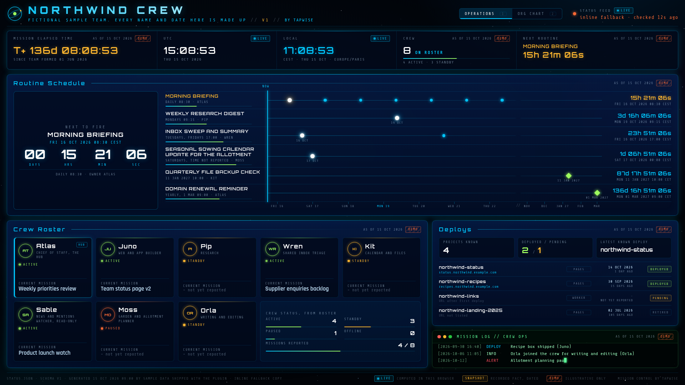

# Mission Control, by Tapwise


A wall-screen dashboard of your own bot team, in the style of a space mission control room.

Free and open source under the MIT licence. Works with Grok Bot and Cursor. Listed under Productivity. More at [tapwise.tech/mission-control](https://tapwise.tech/mission-control). Source: [github.com/guigsybhoy/tapwise-mission-control](https://github.com/guigsybhoy/tapwise-mission-control).

Your bot gathers what it knows about its teammates, their routines and the things they have shipped, writes it to one file called `status.json`, and builds a static page from it. Nothing is made up: every panel says whether it is **LIVE** (worked out in your browser), **SNAPSHOT** (a dated fact) or **DEMO** (sample data), and anything unknown says "not yet reported".



## What you get

**Operations view**
- Mission elapsed time since the team formed, UTC and local clocks, crew count, and the next routine with a ticking countdown.
- A routine timeline for the coming week and beyond, with a countdown for each routine.
- A crew roster card for each bot with its role, status and current task.
- Deploys you know about, with how long ago each went out.
- A mission log terminal that types out your team's history.

**Org chart view**
- You at the top, an optional hub bot underneath, then your bots in groups, each with its remit and the things it does not do.

Press 1 and 2 to switch views, or add `?rotate=60` to the address to swap every minute on a spare screen.

## How to use it

Install the plugin, then ask your bot something like:

- "Build me a mission control dashboard of my bots."
- "Show me the mission control demo."
- "Refresh my mission control now."

Your bot follows the `mission-control` skill. It will:

1. Check a few choices with you (title, how you appear on the org chart, local or deployed).
2. Gather facts from its own context and tools, read-only. It does not contact other bots or people.
3. Write `status.json`, validate it and build the page.
4. Open it as a local file, or deploy it to **your own** Cloudflare Pages if you ask. It recommends putting it behind Cloudflare Access with an email one-time PIN, and walks you through it.
5. Keep it current by default. Your hub bot (or the bot that built it, if there is no hub) saves a standing rule to refresh the board every time it hands out or finishes a job, and sets up a quiet daily catch-up refresh in your evening, at an odd time such as 19:47. Once you have chosen a Cloudflare Pages deploy, refreshes redeploy too; otherwise they just rebuild the local file. Every refresh keeps the honesty rules and runs the privacy check.

Saving the routine may show you a confirmation card. That's expected. The routine stays quiet unless a refresh fails, and then it tells you. Hourly refreshes are possible, but they use more credits, so daily is the default.

## What's in the folder

```
.cursor-plugin/plugin.json      plugin manifest
assets/logo.svg, logo.png       listing logo, 1024 x 1024: the Tapwise mark on a #f7f5ef plate
assets/tapwise-mark-original.svg   the Tapwise mark exactly as served on tapwise.tech
docs/                           screenshots for the listing
skills/mission-control/
  SKILL.md                      the steps your bot follows
  references/schema.md          every field in status.json, and the honesty rules
  references/deploy-cloudflare.md   Cloudflare Pages and Access steps
  template/                     the dashboard: index.html, style.css, app.js, fonts, _headers, status.schema.json
  scripts/validate.py           checks status.json (Python 3, no installs)
  scripts/build.py              validates, then builds a self-contained site folder
  examples/northwind-crew.status.json   fictional sample team
```

## Try the demo by hand

```sh
cd skills/mission-control
python3 scripts/build.py --demo --out /tmp/mission-control-demo
```

Then open `/tmp/mission-control-demo/index.html` in a browser. The Northwind Crew and everything about them is fictional.

## Privacy

- The page makes no outside requests. Fonts are bundled, there is no analytics and no tracking.
- Your data stays in your own files, and on your own Cloudflare account if you deploy.
- The skill tells your bot to keep everything high level: roles and task titles, never email contents, personal or financial details, or account ids. It runs a privacy check before anything is shared or deployed.
- Deployed pages send `noindex` and a strict Content Security Policy.

## Requirements

- Python 3.8 or later, for the validator and build script.
- Any modern browser.
- For deploying: Node.js, Wrangler and a Cloudflare account (the free plan is fine).

## Credits

Fonts: Orbitron (Matt McInerney), Share Tech Mono (Carrois Apostrophe) and Rajdhani (Indian Type Foundry), all under the SIL Open Font License 1.1. Licences are in `skills/mission-control/template/fonts/`.

## Licence

MIT. See `LICENSE`. Copyright 2026 Tapwise.

Made by [Tapwise](https://tapwise.tech).
